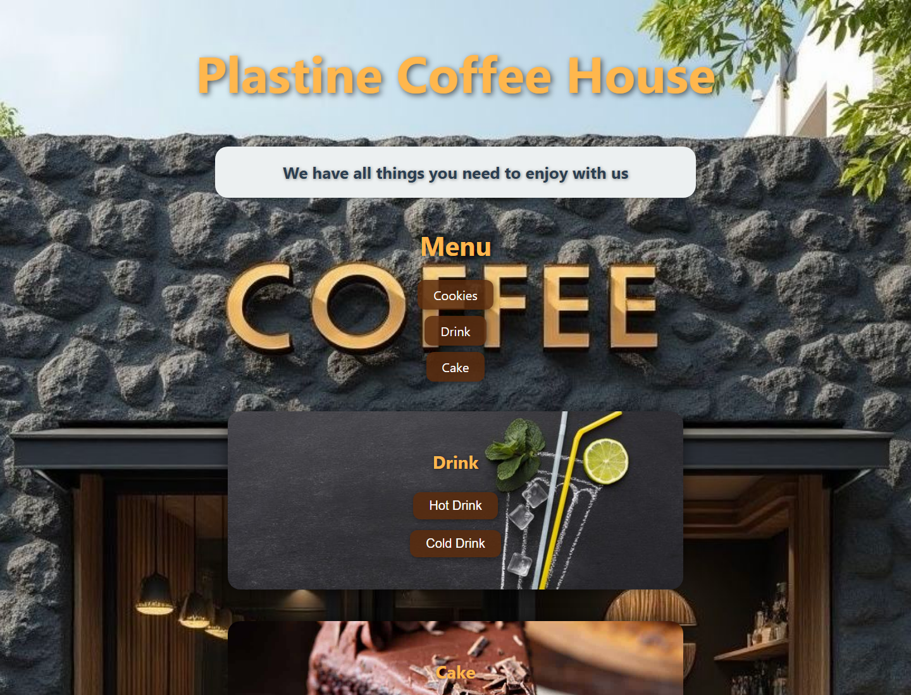

# Plastine Coffee House Menu

A small coffee shop menu with sections for drinks, cakes, and cookies. `index.html` is a static page with local photos and CSS. `project.php` is a separate database backed version that reads the same categories from MySQL.

## Run locally

Open `index.html` in a browser; it works without a server or login. For the PHP version, install PHP with the mysqli extension and MySQL, import `coffee_shop.sql`, configure the local host and database account in `project.php`, then serve the directory with `php -S 127.0.0.1:8000`. Avoid putting database passwords in Git.

## Features

- Category links and expandable menu lists.
- Item names and prices with photographic backgrounds.
- Optional database backed menu via PHP and MySQL.

## Screenshot

Captured from the static page in Chrome:

